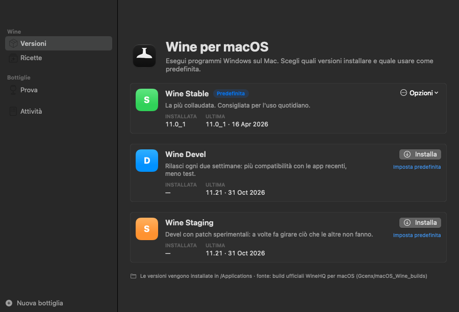
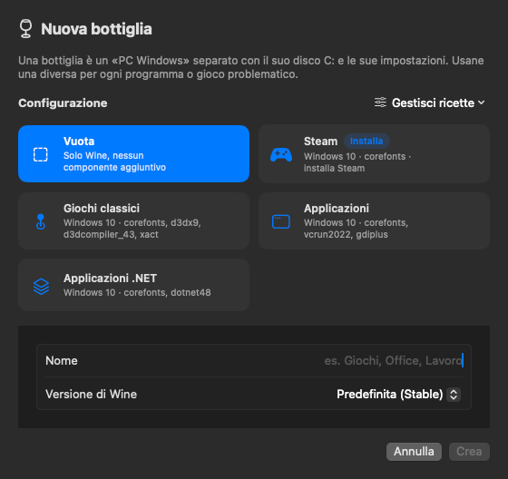
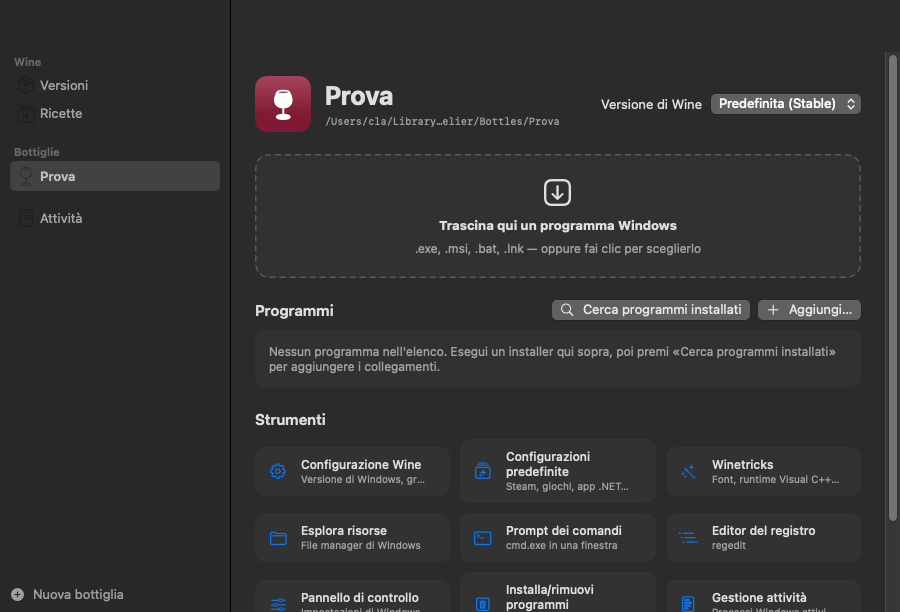
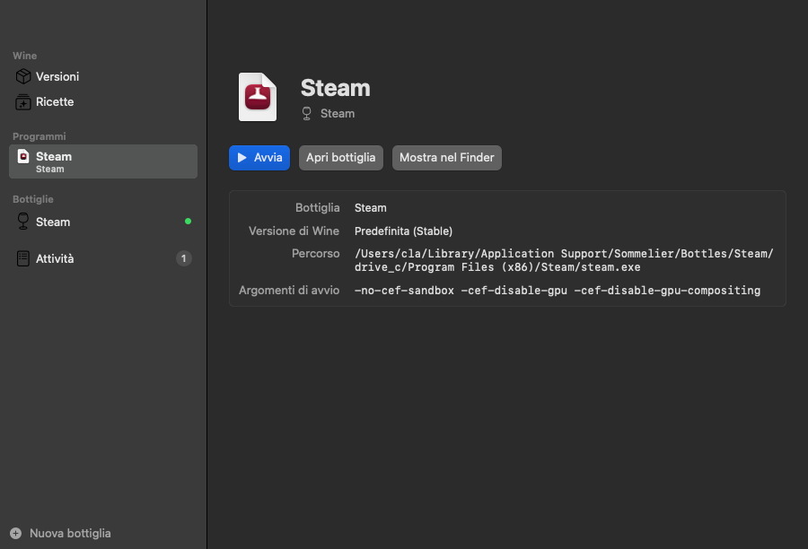
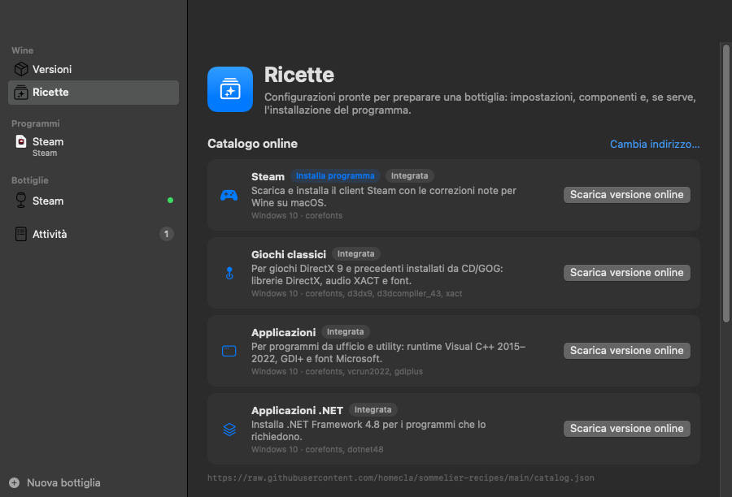
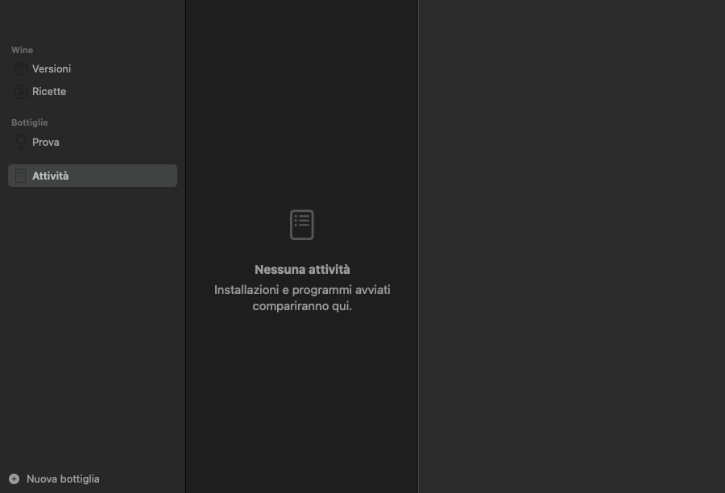

# Sommelier — Guida utente

[English](user-guide.md) · **Italiano**

Sommelier ti permette di usare programmi Windows sul Mac con **Wine**, usando le build
ufficiali WineHQ per macOS. Questa guida spiega come installarlo e come usarlo, dall'app e
dal Terminale.

- [1. Concetti principali](#1-concetti-principali)
- [2. Requisiti](#2-requisiti)
- [3. Installazione](#3-installazione)
- [4. Usare l'app](#4-usare-lapp)
- [5. Esempio: installare Steam](#5-esempio-installare-steam)
- [6. Usare la riga di comando](#6-usare-la-riga-di-comando)
- [7. Tenere tutto aggiornato](#7-tenere-tutto-aggiornato)
- [8. Risoluzione dei problemi](#8-risoluzione-dei-problemi)
- [9. Disinstallazione](#9-disinstallazione)
- [10. Dove si trovano i file](#10-dove-si-trovano-i-file)

---

## 1. Concetti principali

| Termine | Significato |
|---|---|
| **Wine** | Software che fa girare programmi Windows su macOS traducendo le chiamate di Windows in quelle del Mac. Non è un emulatore né una macchina virtuale. |
| **Ramo** | La versione di Wine che installi: **Stable** (la più collaudata, consigliata), **Devel** (più recente, ogni due settimane) o **Staging** (Devel con patch sperimentali). Puoi installarne più di una e scegliere quella predefinita. |
| **Bottiglia** | Un «PC Windows» separato, con il suo disco `C:`, le sue impostazioni e i suoi programmi. Usa una bottiglia diversa per ogni programma o gioco che richiede impostazioni particolari, così non si disturbano a vicenda. |
| **Ricetta** | Una configurazione pronta per una bottiglia: versione di Windows, componenti (font, Visual C++, .NET, DirectX…) e, se serve, l'installazione automatica di un programma come Steam. |

## 2. Requisiti

- Un Mac con **macOS 14 Sonoma o successivo**.
- Sui Mac con **Apple Silicon** (M1, M2, M3…): **Rosetta 2**, perché le build di Wine per
  macOS sono fatte per Intel. Se manca, l'installer propone di installarla.
- Una connessione a internet per scaricare Wine, ricette e programmi.
- Per compilare l'app: i **Command Line Tools** di Apple (`xcode-select --install`) oppure Xcode.

## 3. Installazione

### 3.1 Installare con un solo comando

Apri il **Terminale** ed esegui:

```sh
git clone https://github.com/homecla/sommelier.git
cd sommelier
./install.sh
```

L'installer:

1. installa il comando `sommelier` in `~/.local/bin`;
2. installa Rosetta 2, se serve e manca;
3. compila l'app **Sommelier** e la copia in `/Applicazioni`;
4. installa **Wine Stable**, oppure aggiorna le versioni di Wine che hai già.

Opzioni utili:

```sh
./install.sh --branch devel   # usa Devel come ramo predefinito
./install.sh --no-wine        # installa solo il comando e l'app
```

> Se l'installer dice che `~/.local/bin` non è nel PATH, esegui la riga che suggerisce
> (aggiunge la cartella a `~/.zprofile`), poi apri una nuova finestra del Terminale.

### 3.2 Primo avvio

Apri **Sommelier** dal Launchpad o dalla cartella Applicazioni. Al primo avvio l'app
controlla quali versioni di Wine sono installate e se ci sono aggiornamenti.

L'app parla **italiano** e **inglese**. In automatico segue la lingua del Mac; per cambiarla
apri **Sommelier → Impostazioni** (⌘,) e scegli **Lingua**.

## 4. Usare l'app

La barra laterale ha cinque aree: **Versioni**, **Ricette**, **Programmi** (tutti i programmi
che puoi avviare, in qualsiasi bottiglia), le tue **Bottiglie** e **Attività**.

### 4.1 Versioni di Wine



Per ogni ramo vedi la versione installata e l'ultima disponibile.

- **Installa** scarica la versione, la verifica (SHA-256) e la installa in `/Applicazioni`.
- **Aggiorna a …** compare quando esce una versione più recente. **Aggiorna tutto** aggiorna tutti i rami insieme.
- **Opzioni** → *Usa come predefinita*, *Mostra nel Finder*, *Reinstalla*, *Disinstalla…*
- Il pulsante nella barra degli strumenti (⌘R) ricontrolla gli aggiornamenti.

Gli aggiornamenti non toccano mai le bottiglie né i programmi installati.

### 4.2 Creare una bottiglia

Fai clic su **Nuova bottiglia** in fondo alla barra laterale (⌘N).



1. Scegli una **configurazione**: *Vuota* (solo Wine) o una delle ricette (Steam, Giochi
   classici, Applicazioni, Applicazioni .NET…). Le ricette con l'etichetta **Installa**
   scaricano e installano anche un programma.
2. Scrivi un **Nome** (per esempio «Giochi» o «Ufficio»).
3. Scegli la **Versione di Wine**: *Predefinita* segue il ramo predefinito, oppure scegline una precisa.
4. Fai clic su **Crea** (o **Crea e installa**). Una barra di avanzamento mostra **Passo 3 di 8**,
   cosa sta succedendo e da quanto tempo è in corso il passo, sia nella bottiglia sia in
   **Attività**. La prima volta, preparare una bottiglia richiede circa un minuto.

### 4.3 Eseguire programmi Windows



Apri una bottiglia dalla barra laterale. Per eseguire un programma puoi:

- **trascinare** un file `.exe`, `.msi`, `.bat` o `.lnk` nell'area tratteggiata;
- **fare clic** sull'area tratteggiata e scegliere il file;
- nel Finder, fare clic destro su un file `.exe` → **Apri con → Sommelier**, poi scegliere la bottiglia;
- usare **File → Esegui un programma Windows…** (⌘O).

Gli installer (`setup.exe`, `.msi`) si eseguono come qualsiasi programma: segui le loro
finestre come faresti su Windows.

### 4.4 L'elenco dei programmi

Dopo aver installato qualcosa, fai clic su **Cerca programmi installati**: Sommelier cerca i
collegamenti del menu Start e del Desktop e i programmi in `Program Files`, e ti fa scegliere
quali aggiungere. Puoi anche aggiungere un file a mano con **Aggiungi…**.

Fai clic su un programma per avviarlo. Con il clic destro puoi **Rinomina…**, **Mostra nel
Finder** o **Rimuovi dall'elenco** (il programma resta installato nella bottiglia).

Ogni programma dell'elenco compare anche nella sezione **Programmi** della barra laterale, con
la bottiglia a cui appartiene e un pallino verde quando è in esecuzione. Selezionandolo vedi la
sua pagina: **Avvia**, **Apri bottiglia**, **Mostra nel Finder**, il percorso e gli argomenti di avvio.



### 4.5 Strumenti

Ogni bottiglia ha accesso rapido a:

| Strumento | A cosa serve |
|---|---|
| **Configurazione Wine** | Versione di Windows, grafica, audio, librerie (`winecfg`) |
| **Configurazioni predefinite** | Applicare una ricetta a una bottiglia esistente |
| **Winetricks** | Installare componenti: font, Visual C++, .NET, DirectX… |
| **Esplora risorse** | Sfogliare i dischi della bottiglia come su Windows |
| **Prompt dei comandi** | `cmd.exe` in una finestra |
| **Editor del registro** | `regedit` |
| **Pannello di controllo** | Impostazioni di Windows |
| **Installa/rimuovi programmi** | Disinstallare software Windows |
| **Gestione attività** | Vedere e chiudere i processi Windows |
| **Terminale macOS** | Un Terminale già pronto con `wine`, `winetricks` e `sommelier` per questa bottiglia |
| **Elimina bottiglia** | Sposta nel Cestino la bottiglia e tutto ciò che contiene |

Nella barra degli strumenti: **Apri C:** apre il disco della bottiglia nel Finder;
**Termina tutto** chiude tutti i programmi Windows aperti nella bottiglia.

### 4.6 Winetricks

**Winetricks** installa componenti Windows che servono a molti programmi. Seleziona i
pacchetti più comuni (font Microsoft, Visual C++ 2015–2022, .NET 4.8, DirectX 9…) o scrivine
altri separati da spazi, poi fai clic su **Installa**. Alcuni pacchetti richiedono diversi minuti.

> Molti di questi pacchetti sono software Microsoft scaricato dai server di Microsoft:
> installandoli accetti le relative condizioni di licenza.

### 4.7 Ricette e catalogo online



La sezione **Ricette** mostra:

- **Catalogo online**: le ricette pubblicate su
  [homecla/sommelier-recipes](https://github.com/homecla/sommelier-recipes). Fai clic su
  **Installa** per scaricarne una (l'impronta SHA-256 viene verificata), su **Aggiorna**
  quando ne esce una versione più recente, oppure su **Scarica versione online** per
  sostituire una ricetta integrata con quella del catalogo.
- **Sul tuo Mac**: le ricette integrate, scaricate e personali. Il menu **Gestisci ricette**
  aggiunge ricette da file o da indirizzo web, aggiorna quelle scaricate, crea una ricetta
  personale da un modello e apre la cartella delle ricette personali.

> **Sicurezza.** Le ricette non vengono mai eseguite come script: Sommelier legge solo le
> impostazioni previste. Una ricetta può comunque scaricare ed eseguire un installer nella
> bottiglia, quindi aggiungi solo ricette di fonti di cui ti fidi.

### 4.8 Attività



Ogni installazione, ricetta e programma avviato compare qui con il suo registro; installazioni
e ricette in corso mostrano la loro barra di avanzamento. Usa **Copia**
per copiare un registro (utile per chiedere aiuto), **Interrompi** per fermare un'operazione
in corso e **Pulisci completate** per riordinare l'elenco.

### 4.9 Impostazioni

**Sommelier → Impostazioni** (⌘,):

- **Lingua**: Automatica, English o Italiano.
- **Controlla gli aggiornamenti di Wine all'avvio**.
- **Log dettagliati di Wine**: attivali quando un programma non parte, poi guarda il suo
  registro in **Attività**.

## 5. Esempio: installare Steam

1. Fai clic su **Nuova bottiglia**, scegli la configurazione **Steam** e chiamala «Steam».
2. Fai clic su **Crea e installa** e attendi: Sommelier imposta Windows 10, installa i font
   Microsoft, scarica l'installer ufficiale di Valve, installa Steam e aggiunge il correttivo di
   Sommelier per la finestra di Steam.
3. Alla fine **Steam** compare in **Programmi** e nell'elenco dei programmi della bottiglia, con
   le opzioni di avvio giuste. Fai clic: al primo avvio Steam scarica il proprio aggiornamento
   (qualche centinaio di MB), poi mostra la finestra di accesso.

> **La finestra di Steam.** Con Wine «puro» su macOS la finestra di Steam resterebbe nera: la
> sua interfaccia è un browser che disegna in un processo separato, che il driver di Wine per
> macOS non riesce a mostrare. La ricetta installa un piccolo correttivo di Sommelier che fa
> disegnare il browser nel proprio processo ([come funziona](https://github.com/homecla/sommelier/tree/main/fixes/steam-webhelper/README.it.md)). I file di
> Steam non vengono modificati, quindi Steam continua ad aggiornarsi da solo. Se la finestra è
> nera, la bottiglia è stata preparata con una versione precedente di Sommelier: aggiorna
> Sommelier, poi apri la bottiglia → **Configurazioni predefinite** → **Steam** → **Applica**.
>
> I file di Steam non vengono modificati, ma il correttivo agisce dentro il processo del browser di Steam. Le condizioni d'uso di Steam (Steam Subscriber Agreement) limitano le modifiche al client: correttivi di compatibilità di questo tipo sono comuni negli strumenti che eseguono Steam con Wine, ma la decisione di usarlo spetta a te.

> I giochi DirectX 9 e molti indie girano bene. Con Wine «puro» su macOS i giochi DirectX
> 11/12 spesso no: servono livelli di traduzione come D3DMetal o DXVK (inclusi in CrossOver
> o nel Game Porting Toolkit di Apple).

## 6. Usare la riga di comando

Tutto ciò che fa l'app è disponibile anche nel Terminale con `sommelier`
(`sommelier help` mostra l'elenco completo).

```sh
# Versioni di Wine
sommelier status -r                  # versioni installate e aggiornamenti
sommelier install devel              # installa un ramo
sommelier update                     # aggiorna le versioni installate
sommelier default staging            # cambia il ramo predefinito
sommelier uninstall staging          # rimuove una versione

# Bottiglie
sommelier bottle create Giochi -P giochi-classici  # nuova bottiglia con una ricetta
sommelier bottle list
sommelier bottle apply Giochi applicazioni         # applica una ricetta a una bottiglia
sommelier bottle delete Giochi

# Programmi
sommelier run -B Giochi setup.exe    # esegue un file in una bottiglia
sommelier run -B Giochi winecfg      # avvia uno strumento di Wine
sommelier start -B Steam Steam       # avvia un programma salvato con le sue opzioni
sommelier winetricks -B Giochi corefonts vcrun2022
sommelier kill -B Giochi             # chiude tutti i programmi della bottiglia

# Ricette e catalogo
sommelier preset list
sommelier catalog                    # catalogo online
sommelier catalog install steam
sommelier catalog update

# Sistema
sommelier doctor                     # controlla Rosetta, permessi, dipendenze
```

La lingua segue quella del Mac; per forzarla usa `SOMMELIER_LANG=it` o `SOMMELIER_LANG=en`.

## 7. Tenere tutto aggiornato

| Cosa | Come |
|---|---|
| Wine | **Versioni → Aggiorna tutto** nell'app, oppure `sommelier update` |
| Ricette del catalogo | **Ricette → Aggiorna**, oppure `sommelier catalog update` |
| Sommelier stesso | nella cartella del progetto: `git pull && ./install.sh` |

## 8. Risoluzione dei problemi

**«Rosetta 2 non è installato»**: fai clic su **Installa Rosetta** in Versioni, oppure esegui
`sommelier rosetta`.

**Un programma non parte**: attiva **Log dettagliati di Wine** nelle Impostazioni, avvialo di
nuovo e leggi il suo registro in **Attività**. Spesso la causa è un componente mancante: prova
**Winetricks** (per esempio `vcrun2022`, `corefonts`, `dotnet48`) o una ricetta.

**Un gioco mostra lo schermo nero o si chiude**: i giochi DirectX 11/12 di solito non sono
supportati da Wine «puro» su macOS (vedi la nota nella sezione 5). I giochi più vecchi a volte
funzionano meglio impostando Windows 7 o XP in **Configurazione Wine**.

**«Wine … è in uso»** durante un aggiornamento: chiudi i programmi Windows (o fai clic su
**Termina tutto** nella bottiglia, o esegui `sommelier kill`) e riprova.

**Winetricks non riesce a installare**: molti pacchetti richiedono `cabextract`, che si
installa con `brew install cabextract`.

**Impossibile controllare gli aggiornamenti**: Sommelier deve raggiungere GitHub. Controlla la
connessione e fai clic su **Riprova**. Le versioni installate funzionano anche offline.

**Altro**: esegui `sommelier doctor`, che controlla Rosetta, permessi, dipendenze e connessione.

## 9. Disinstallazione

1. Chiudi **Sommelier** (⌘Q) e gli eventuali programmi Windows aperti.
2. Rimuovi le versioni di Wine da **Versioni** (oppure `sommelier uninstall <ramo>`).
3. Trascina **Sommelier** dalla cartella Applicazioni al Cestino.
4. Rimuovi il comando e le ricette:
   `rm ~/.local/bin/sommelier && rm -r ~/.local/share/sommelier`
5. Per cancellare anche **tutte le bottiglie e i loro programmi**, sposta nel Cestino
   `~/Library/Application Support/Sommelier`. Una volta svuotato il Cestino non si torna indietro.
6. Rimuovi i file delle impostazioni:
   `rm ~/Library/Preferences/io.github.homecla.sommelier.plist ~/Library/Preferences/org.winehq.wine.plist`
   (`defaults delete` non basta: svuota i file ma li lascia al loro posto).

## 10. Dove si trovano i file

| Cosa | Dove |
|---|---|
| Wine (build ufficiali WineHQ) | `/Applications/Wine Stable.app`, `Wine Devel.app`, `Wine Staging.app` |
| L'app | `/Applications/Sommelier.app` |
| Il comando | `~/.local/bin/sommelier` |
| Bottiglie, ricette personali, winetricks, cache | `~/Library/Application Support/Sommelier/` |
| Ricette integrate | `~/.local/share/sommelier/presets/` |
| Impostazioni dell'app | `~/Library/Preferences/io.github.homecla.sommelier.plist` |

---

Sommelier è software libero con licenza AGPL-3.0-or-later. Le ricette sono in CC0.
È un progetto indipendente, non affiliato a WineHQ, CodeWeavers, Microsoft, Valve o Apple; tutti i marchi appartengono ai rispettivi titolari.
