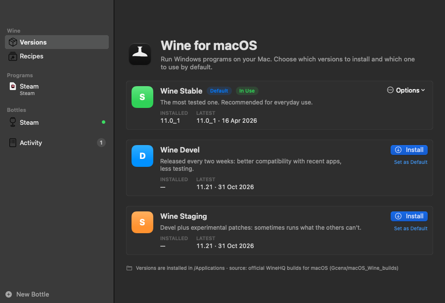
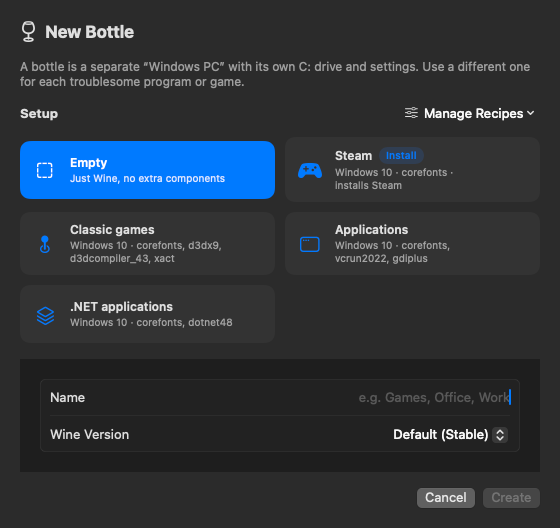
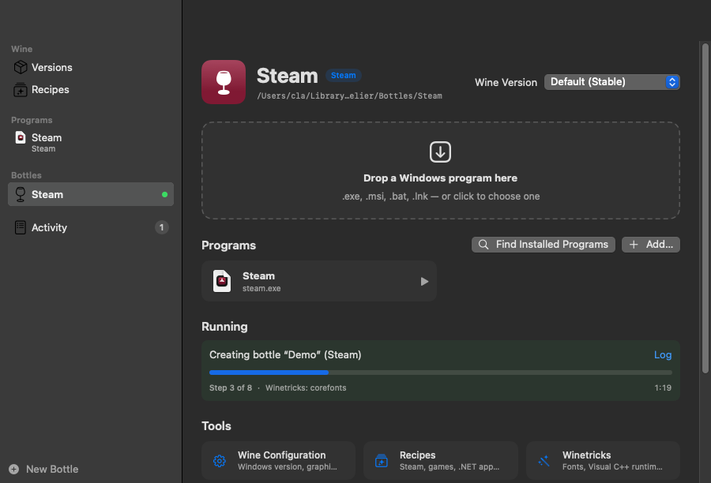
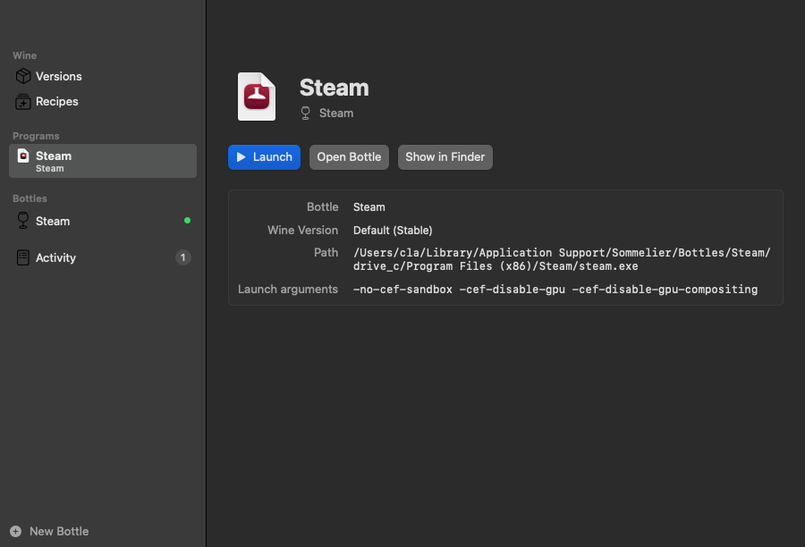
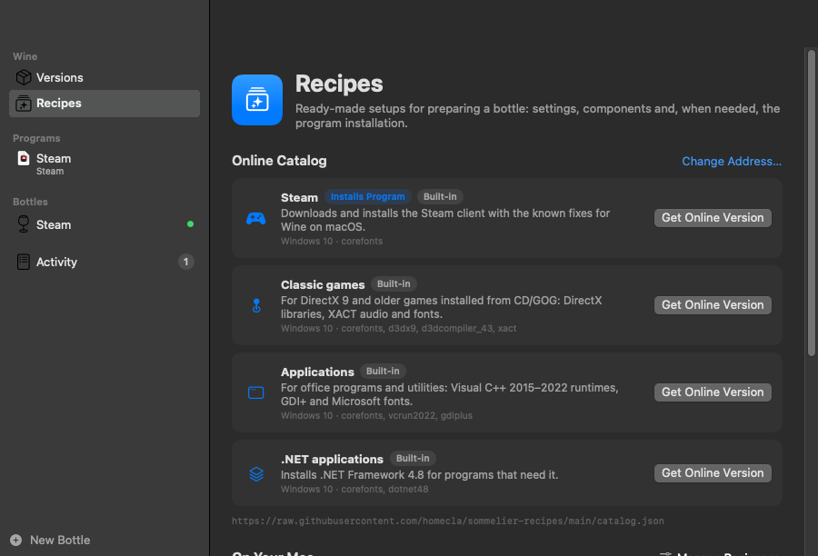
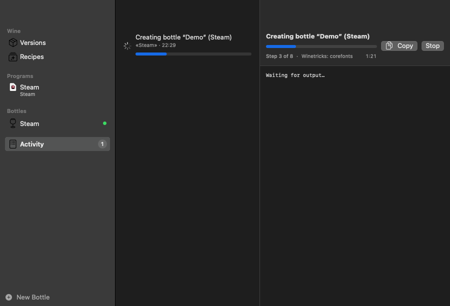

# Sommelier — User Guide

**English** · [Italiano](guida-utente.md)

Sommelier lets you run Windows programs on your Mac with **Wine**, using the official
WineHQ builds for macOS. This guide explains how to install it and how to use it, from
the app and from the Terminal.

- [1. Key ideas](#1-key-ideas)
- [2. Requirements](#2-requirements)
- [3. Installation](#3-installation)
- [4. Using the app](#4-using-the-app)
- [5. Example: installing Steam](#5-example-installing-steam)
- [6. Using the command line](#6-using-the-command-line)
- [7. Keeping everything up to date](#7-keeping-everything-up-to-date)
- [8. Troubleshooting](#8-troubleshooting)
- [9. Uninstalling](#9-uninstalling)
- [10. Where files are stored](#10-where-files-are-stored)

---

## 1. Key ideas

| Term | Meaning |
|---|---|
| **Wine** | Software that runs Windows programs on macOS by translating Windows calls into Mac ones. It is not an emulator or a virtual machine. |
| **Branch** | The Wine version you install: **Stable** (most tested, recommended), **Devel** (newer, every two weeks) or **Staging** (Devel plus experimental patches). You can install several and choose the default one. |
| **Bottle** | A separate “Windows PC” with its own `C:` drive, settings and programs. Use a different bottle for each program or game that needs special settings, so they don't interfere with each other. |
| **Recipe** | A ready-made setup for a bottle: Windows version, components (fonts, Visual C++, .NET, DirectX…) and, when needed, the automatic installation of a program such as Steam. |

## 2. Requirements

- A Mac running **macOS 14 Sonoma or later**.
- On Macs with **Apple Silicon** (M1, M2, M3…): **Rosetta 2**, because Wine builds for macOS
  are made for Intel. The installer offers to install it if it's missing.
- An internet connection to download Wine, recipes and programs.
- To build the app: Apple's **Command Line Tools** (`xcode-select --install`) or Xcode.

## 3. Installation

### 3.1 Install with one command

Open **Terminal** and run:

```sh
git clone https://github.com/homecla/sommelier.git
cd sommelier
./install.sh
```

The installer:

1. installs the `sommelier` command in `~/.local/bin`;
2. installs Rosetta 2 if it is needed and missing;
3. builds the **Sommelier** app and copies it into `/Applications`;
4. installs **Wine Stable**, or updates the Wine versions you already have.

Useful options:

```sh
./install.sh --branch devel   # use Devel as the default branch
./install.sh --no-wine        # install only the command and the app
```

> If the installer says `~/.local/bin` is not in your PATH, run the line it suggests
> (it adds the folder to `~/.zprofile`), then open a new Terminal window.

### 3.2 First launch

Open **Sommelier** from Launchpad or from the Applications folder. On the first launch
the app checks which Wine versions are installed and whether updates are available.

The app speaks **English** and **Italian**. By default it follows your Mac's language; to
change it, open **Sommelier → Settings** (⌘,) and choose **Language**.

## 4. Using the app

The sidebar has five areas: **Versions**, **Recipes**, **Programs** (every program you can
launch, in any bottle), your **Bottles** and **Activity**.

### 4.1 Wine versions



For each branch you can see the installed version and the latest available one.

- **Install** downloads the version, verifies it (SHA-256) and installs it in `/Applications`.
- **Update to …** appears when a newer version is out. **Update All** updates every branch at once.
- **Options** → *Use as Default*, *Show in Finder*, *Reinstall*, *Uninstall…*
- The toolbar button (⌘R) checks for updates again.

Bottles and installed programs are never touched by updates.

### 4.2 Creating a bottle

Click **New Bottle** at the bottom of the sidebar (⌘N).



1. Choose a **setup**: *Empty* (just Wine) or one of the recipes (Steam, Classic games,
   Applications, .NET applications…). Recipes marked **Install** also download and install
   a program.
2. Type a **Name** (for example “Games” or “Office”).
3. Choose the **Wine Version**: *Default* follows the default branch, or pick a specific one.
4. Click **Create** (or **Create and Install**). A progress bar shows **Step 3 of 8**, what
   is happening and how long the current step has been running, both in the bottle and in
   **Activity**. The first time, preparing a bottle takes about a minute.

### 4.3 Running Windows programs



Open a bottle from the sidebar. To run a program you can:

- **drag** a `.exe`, `.msi`, `.bat` or `.lnk` file onto the dashed area;
- **click** the dashed area and choose the file;
- in Finder, right-click a `.exe` file → **Open With → Sommelier**, then choose the bottle;
- use **File → Run a Windows Program…** (⌘O).

Installers (`setup.exe`, `.msi`) run like any other program: follow their windows as you
would on Windows.

### 4.4 The program list

After installing something, click **Find Installed Programs**: Sommelier looks for Start menu
and Desktop shortcuts and for programs in `Program Files`, and lets you choose which ones to
add. You can also add a file by hand with **Add…**.

Click a program to launch it. Right-click it to **Rename…**, **Show in Finder** or
**Remove from List** (the program stays installed in the bottle).

Every program in the list also appears in the **Programs** section of the sidebar, with the
bottle it belongs to and a green dot while it is running. Select it to see its page: **Launch**,
**Open Bottle**, **Show in Finder**, its path and its launch arguments.



### 4.5 Tools

Each bottle has quick access to:

| Tool | What it's for |
|---|---|
| **Wine Configuration** | Windows version, graphics, audio, libraries (`winecfg`) |
| **Recipes** | Apply a recipe to an existing bottle |
| **Winetricks** | Install components: fonts, Visual C++, .NET, DirectX… |
| **File Explorer** | Browse the bottle's drives the Windows way |
| **Command Prompt** | `cmd.exe` in a window |
| **Registry Editor** | `regedit` |
| **Control Panel** | Windows settings |
| **Add/Remove Programs** | Uninstall Windows software |
| **Task Manager** | See and end Windows processes |
| **macOS Terminal** | A Terminal ready with `wine`, `winetricks` and `sommelier` for this bottle |
| **Delete Bottle** | Moves the bottle and everything in it to the Trash |

In the toolbar: **Open C:** opens the bottle's drive in Finder; **Quit All** closes every
Windows program running in the bottle.

### 4.6 Winetricks

**Winetricks** installs Windows components that many programs need. Select the common
packages (Microsoft fonts, Visual C++ 2015–2022, .NET 4.8, DirectX 9…) or type others,
separated by spaces, then click **Install**. Some packages take several minutes.

> Many of these packages are Microsoft software downloaded from Microsoft's servers:
> by installing them you accept their license terms.

### 4.7 Recipes and the online catalog



The **Recipes** section shows:

- **Online Catalog**: recipes published at
  [homecla/sommelier-recipes](https://github.com/homecla/sommelier-recipes). Click **Install**
  to download one (its SHA-256 fingerprint is checked), **Update** when a newer version is
  available, or **Get Online Version** to replace a built-in recipe with the catalog one.
- **On Your Mac**: built-in, downloaded and personal recipes. The **Manage Recipes** menu
  adds recipes from a file or web address, updates downloaded ones, creates a personal
  recipe from a template, and opens the personal recipes folder.

> **Safety.** Recipes are never executed as scripts: Sommelier reads only known settings.
> A recipe can still download and run an installer inside the bottle, so only add recipes
> from sources you trust.

### 4.8 Activity



Every installation, recipe and program you launch appears here with its log; running
installations and recipes show their progress bar. Use **Copy** to
copy a log (useful when asking for help), **Stop** to end a running task and **Clear
Completed** to tidy up the list.

### 4.9 Settings

**Sommelier → Settings** (⌘,):

- **Language**: Automatic, English or Italian.
- **Check for Wine updates at launch**.
- **Detailed Wine logs**: turn this on when a program won't start, then look at its log in
  **Activity**.

## 5. Example: installing Steam

1. Click **New Bottle**, choose the **Steam** setup, name it “Steam”.
2. Click **Create and Install** and wait: Sommelier sets Windows 10, installs the Microsoft
   fonts, downloads Valve's official installer and installs Steam.
3. When it finishes, **Steam** appears in the bottle's program list with the right launch
   options. Click it and sign in.

> DirectX 9 games and many indie games run well. With plain Wine on macOS, DirectX 11/12
> games often don't: they need translation layers such as D3DMetal or DXVK (included in
> CrossOver or Apple's Game Porting Toolkit). If Steam's window stays black, close it and
> launch Steam again from the bottle.

## 6. Using the command line

Everything the app does is also available in Terminal with `sommelier`
(`sommelier help` shows the full list).

```sh
# Wine versions
sommelier status -r                  # installed versions and updates
sommelier install devel              # install a branch
sommelier update                     # update installed versions
sommelier default staging            # change the default branch
sommelier uninstall staging          # remove a version

# Bottles
sommelier bottle create Games -P giochi-classici   # new bottle with a recipe
sommelier bottle list
sommelier bottle apply Games applicazioni          # apply a recipe to a bottle
sommelier bottle delete Games

# Programs
sommelier run -B Games setup.exe     # run a file in a bottle
sommelier run -B Games winecfg       # run a Wine tool
sommelier start -B Steam Steam       # launch a saved program with its options
sommelier winetricks -B Games corefonts vcrun2022
sommelier kill -B Games              # close every program in the bottle

# Recipes and catalog
sommelier preset list
sommelier catalog                    # online catalog
sommelier catalog install steam
sommelier catalog update

# System
sommelier doctor                     # check Rosetta, permissions, dependencies
```

The language follows your Mac; to force it use `SOMMELIER_LANG=en` or `SOMMELIER_LANG=it`.

## 7. Keeping everything up to date

| What | How |
|---|---|
| Wine | **Versions → Update All** in the app, or `sommelier update` |
| Recipes from the catalog | **Recipes → Update**, or `sommelier catalog update` |
| Sommelier itself | in the project folder: `git pull && ./install.sh` |

## 8. Troubleshooting

**“Rosetta 2 is not installed”** — click **Install Rosetta** in Versions, or run
`sommelier rosetta`.

**A program doesn't start** — turn on **Detailed Wine logs** in Settings, launch it again
and read its log in **Activity**. Often a missing component is the cause: try **Winetricks**
(for example `vcrun2022`, `corefonts`, `dotnet48`) or a recipe.

**A game shows a black screen or crashes** — DirectX 11/12 games are usually not supported by
plain Wine on macOS (see the note in section 5). Older games may work better with Windows 7
or XP set in **Wine Configuration**.

**“Wine … is in use”** while updating — close the Windows programs (or click **Quit All** in
the bottle, or run `sommelier kill`) and try again.

**Winetricks fails** — many packages need `cabextract`: install it with
`brew install cabextract`.

**Updates can't be checked** — Sommelier needs to reach GitHub. Check your connection and
click **Try Again**. Installed versions keep working offline.

**Something else** — run `sommelier doctor`: it checks Rosetta, permissions, dependencies
and the connection.

## 9. Uninstalling

1. Quit **Sommelier** (⌘Q) and any Windows program that is running.
2. Remove Wine versions from **Versions** (or `sommelier uninstall <branch>`).
3. Drag **Sommelier** from Applications to the Trash.
4. Remove the command and recipes:
   `rm ~/.local/bin/sommelier && rm -r ~/.local/share/sommelier`
5. To also delete **all bottles and their programs**, move
   `~/Library/Application Support/Sommelier` to the Trash. This cannot be undone once
   the Trash is emptied.
6. Remove the settings files:
   `rm ~/Library/Preferences/io.github.homecla.sommelier.plist ~/Library/Preferences/org.winehq.wine.plist`
   (`defaults delete` is not enough: it empties the files but leaves them in place).

## 10. Where files are stored

| What | Where |
|---|---|
| Wine (official WineHQ builds) | `/Applications/Wine Stable.app`, `Wine Devel.app`, `Wine Staging.app` |
| The app | `/Applications/Sommelier.app` |
| The command | `~/.local/bin/sommelier` |
| Bottles, personal recipes, winetricks, cache | `~/Library/Application Support/Sommelier/` |
| Built-in recipes | `~/.local/share/sommelier/presets/` |
| App settings | `~/Library/Preferences/io.github.homecla.sommelier.plist` |

---

Sommelier is free software under the AGPL-3.0-or-later license. Recipes are CC0.
It is an independent project, not affiliated with WineHQ, CodeWeavers, Microsoft, Valve or Apple; all trademarks belong to their owners.
